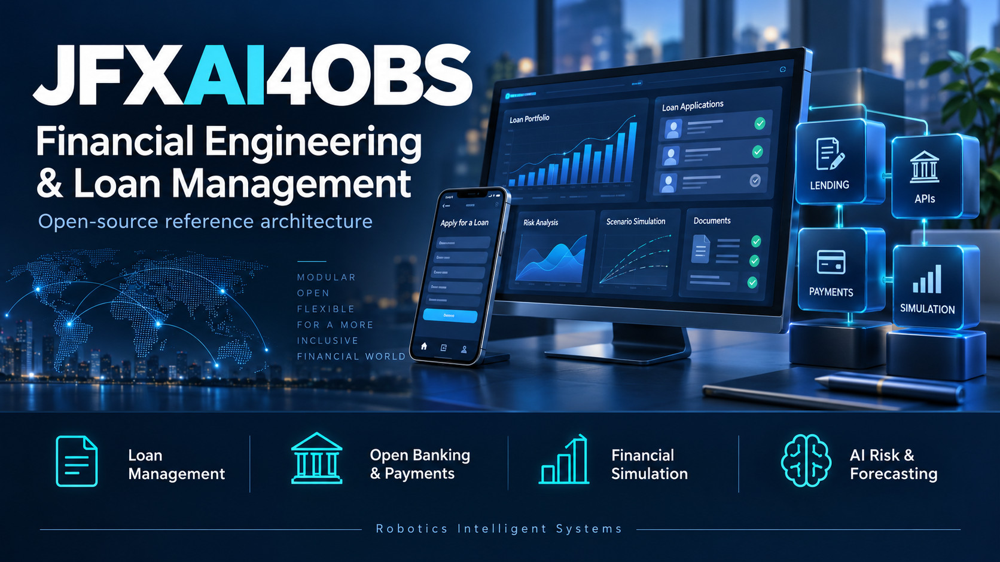
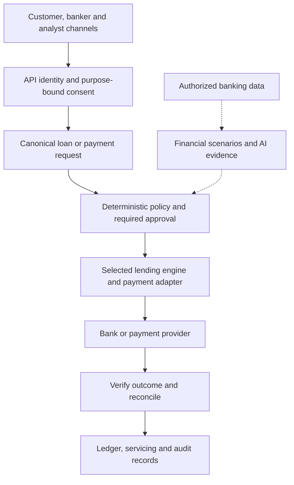
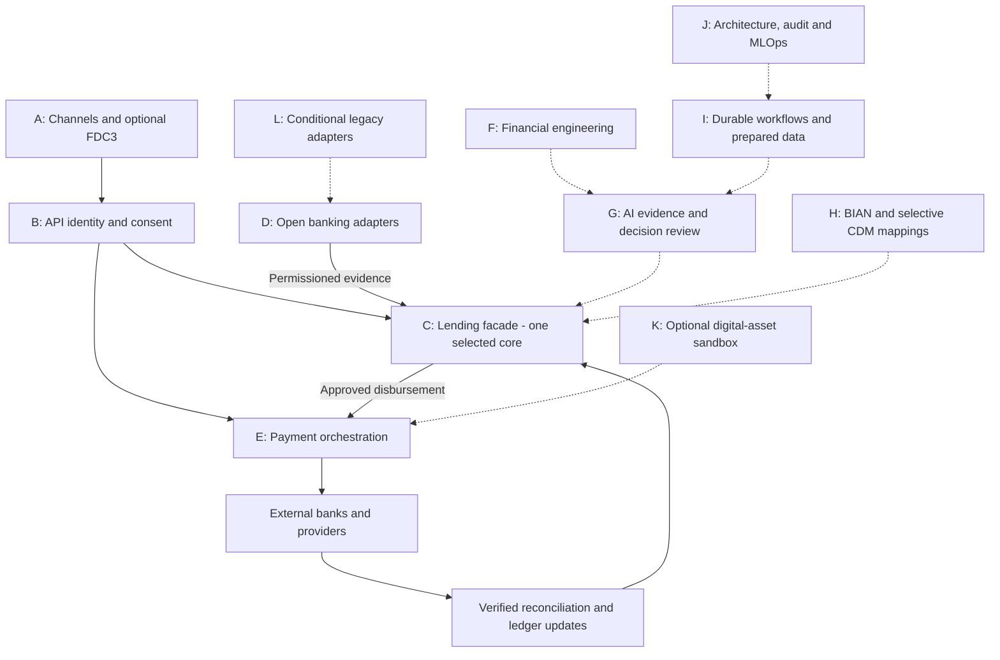
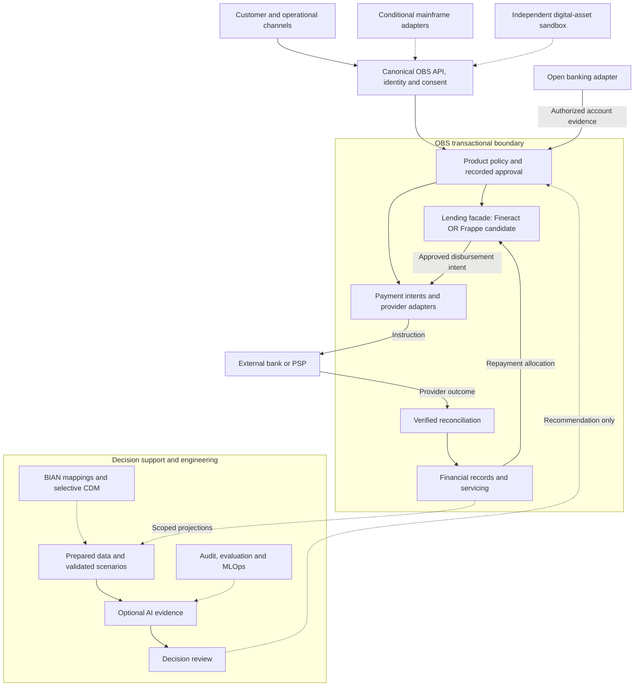
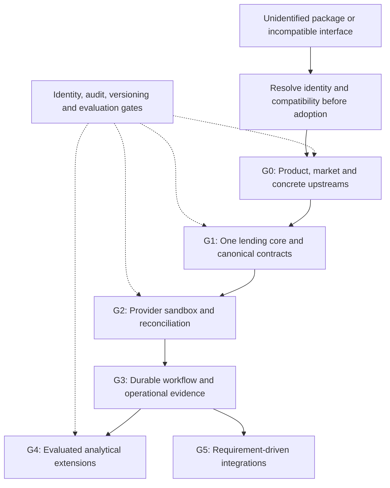
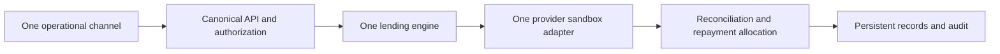
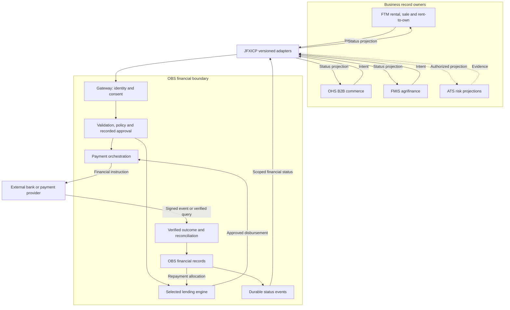
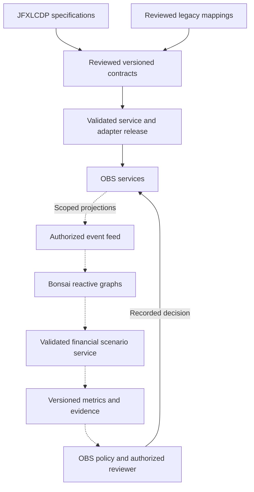
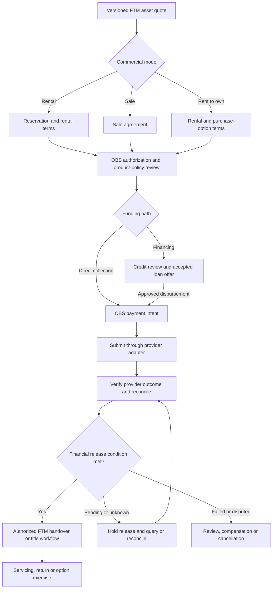

<p align="center">
  <a href="./financial-engineering-showcase.jpg">
    
  </a>
</p>

# Financial Engineering & Loan Management Building-Block Architecture

> Modular reference architecture for an open financial platform centered on **Loan Management**, **Open Banking**, **Payments**, **Financial Engineering**, and **AI-assisted risk/forecasting**, using the original open-source software compendium as a set of replaceable building blocks.

## Table of Contents

- [1. Architectural Direction](#1-architectural-direction)
- [2. Building-Block Map](#2-building-block-map)
- [3. Building Block A — Experience & Financial Desktop](#3-building-block-a--experience--financial-desktop)
- [4. Building Block B — Identity, Consent & Trust](#4-building-block-b--identity-consent--trust)
- [5. Building Block C — Loan Origination & Loan Management Core](#5-building-block-c--loan-origination--loan-management-core)
- [6. Building Block D — Open Banking](#6-building-block-d--open-banking)
- [7. Building Block E — Payments & Settlement](#7-building-block-e--payments--settlement)
- [8. Building Block F — Financial Engineering Engine](#8-building-block-f--financial-engineering-engine)
- [9. Building Block G — AI Financial Decision Engine](#9-building-block-g--ai-financial-decision-engine)
- [10. Building Block H — Financial Semantic & Industry Standards](#10-building-block-h--financial-semantic--industry-standards)
- [11. Building Block I — Workflow & Data Preparation](#11-building-block-i--workflow--data-preparation)
- [12. Building Block J — Enterprise Architecture & Governance](#12-building-block-j--enterprise-architecture--governance)
- [13. Building Block K — Digital Assets & Decentralized Finance](#13-building-block-k--digital-assets--decentralized-finance)
- [14. Building Block L — Legacy Banking & Mainframe Modernization](#14-building-block-l--legacy-banking--mainframe-modernization)
- [15. External / Non-Open-Source Reference Block](#15-external--non-open-source-reference-block)
- [16. Consolidated Building-Block Architecture](#16-consolidated-building-block-architecture)
- [17. Recommended Logical Services](#17-recommended-logical-services)
- [18. Integration Rules](#18-integration-rules)
- [19. Open-Source Software Compendium — Architectural Classification](#19-open-source-software-compendium--architectural-classification)
- [19.1 Dependency priority analysis](#191-dependency-priority-analysis)
- [20. Recommended MVP](#20-recommended-mvp)
- [21. Evolution Roadmap](#21-evolution-roadmap)
- [22. Architectural Principle](#22-architectural-principle)
- [23. Standalone OBS Payment and Credit Gateway with FTM Rental and Sales](#23-standalone-obs-payment-and-credit-gateway-with-ftm-rental-and-sales)
  - [23.1 Scope, status and financial ownership](#231-scope-status-and-financial-ownership)
  - [23.2 Integrated subsystem registry](#232-integrated-subsystem-registry)
  - [23.3 Mapping to the original OBS compendium](#233-mapping-to-the-original-obs-compendium)
  - [23.4 Consolidated architecture](#234-consolidated-architecture)
  - [23.5 Gateway and payment process](#235-gateway-and-payment-process)
  - [23.6 Credit and loan process](#236-credit-and-loan-process)
  - [23.7 JFXAI4FTM rental, sale and rent-to-own](#237-jfxai4ftm-rental-sale-and-rent-to-own)
  - [23.8 FTM business-to-finance process](#238-ftm-business-to-finance-process)
  - [23.9 Canonical financial and commercial contracts](#239-canonical-financial-and-commercial-contracts)
  - [23.10 Bonsai reactive middleware](#2310-bonsai-reactive-middleware)
  - [23.11 AI decision support](#2311-ai-decision-support)
  - [23.12 Operational controls and data boundaries](#2312-operational-controls-and-data-boundaries)
  - [23.13 Deployment profiles](#2313-deployment-profiles)
  - [23.14 Delivery roadmap and acceptance criteria](#2314-delivery-roadmap-and-acceptance-criteria)
  - [23.15 Proposed integration manifest](#2315-proposed-integration-manifest)
  - [23.16 Sources and review notes](#2316-sources-and-review-notes)

---

## 1. Architectural Direction

The integration should not treat the listed projects as one flat dependency list.

Instead, each project is assigned to a **building block** with a clearly defined responsibility and interface.

The primary business path is:



The AI layer is therefore **embedded inside financial workflows** rather than operating as a generic standalone assistant.

---

# 2. Building-Block Map



---

# 3. Building Block A — Experience & Financial Desktop

## Purpose

Provide user-facing channels without coupling business logic to any specific frontend.

### Components

| Component | Role | Classification |
|---|---|---|
| **FDC3** | Interoperability standard for financial desktop applications | Recommended Standard |
| **Mifos X Web App** | Reference UI for financial/loan workflows | Optional UI |
| **Frappe UI / ERP-style frontends** | Loan and operational user interface | Optional UI |
| **Hibiscus** | Reference online-banking client | Research / Optional |
| Custom Web / Mobile Apps | Customer and staff channels | Project Layer |

### Interface Contract

```text
UI
 ↓
REST / OpenAPI / Events
 ↓
Financial Services API
```

The frontend should never directly own loan-accounting or underwriting logic.

---

# 4. Building Block B — Identity, Consent & Trust

## Purpose

Provide identity, authorization, customer consent, and decentralized credentials.

### Components

| Component | Role | Classification |
|---|---|---|
| **ACA-Py** | Decentralized identity / verifiable credential foundation | Optional Integration |
| **Open Bank Project** | Open banking API and authorization patterns | Strategic Integration |
| **Swedbank PSD2 / Saturn Interface** | PSD2 interface/reference integration | Reference / Adapter |
| OAuth2 / OIDC | API identity and authorization | Required Standard |
| mTLS / signed requests | Bank-grade channel security | Required Capability |

### Concept

```text
Customer Identity
       |
Consent / Authorization
       |
Open Banking API
       |
Loan / Payment Services
```

ACA-Py can be used where decentralized credentials provide value, but it should remain independently replaceable.

---

# 5. Building Block C — Loan Origination & Loan Management Core

This is the **center of the proposed architecture**.

Rather than choosing one project globally, the architecture supports a **Loan Domain Interface** behind which one or more open-source lending systems can be evaluated.

## Candidate Engines

| Project | Best Architectural Role |
|---|---|
| **OpenCBS Loan Origination Solution** | Loan origination, underwriting workflow, microfinance reference |
| **Apache Fineract** | Core lending/account servicing engine |
| **Mifos X Web App** | Operational UI and ecosystem around Fineract |
| **Frappe Lending** | ERP-integrated Loan Management System |
| **CashMan Financial Banking System** | Banking-system reference / candidate core |

## Loan Domain Services

```text
Loan Application
      |
      v
Customer / KYC
      |
      v
Eligibility
      |
      v
Credit Assessment
      |
      v
Pricing & Terms
      |
      v
Approval Workflow
      |
      v
Contract
      |
      v
Disbursement
      |
      v
Repayment Schedule
      |
      v
Servicing
      |
      +---- Collections
      +---- Restructuring
      +---- Early Settlement
      +---- Delinquency
      +---- Portfolio Monitoring
```

## Canonical Loan API

A stable API façade should isolate the rest of JFXAI4OBS from the selected lending engine.

```text
POST /loan-applications
POST /credit-assessments
POST /loan-offers
POST /loans
GET  /loans/{id}
GET  /loans/{id}/schedule
POST /loans/{id}/payments
POST /loans/{id}/restructure
GET  /portfolios/{id}/risk
```

This permits OpenCBS, Fineract, or Frappe Lending to be swapped or combined without redesigning the whole platform.

---

# 6. Building Block D — Open Banking

## Purpose

Connect the lending platform to financial institutions, account data, consent, payment initiation, and external banking services.

### Components

- **Open Bank Project**
- **Swedbank PSD2 / Saturn Interface**
- **PyFinTS**
- PSD2 / XS2A adapters
- Open Finance APIs

### Uses

- account verification;
- transaction-history ingestion;
- affordability analysis;
- income/cash-flow analysis;
- payment initiation;
- bank-account reconciliation;
- customer-permissioned financial data.

```text
External Bank
     |
PSD2 / FinTS / Open Banking
     |
Open Banking Gateway
     |
Canonical Financial API
     |
Loan + Risk Engine
```

---

# 7. Building Block E — Payments & Settlement

### Components

| Project / Standard | Role |
|---|---|
| **SEPA Credit Transfer** | European bank-transfer rail |
| **SEPA Direct Debit** | Recurring loan repayment / debit rail |
| **Hyperswitch** | Composable payment orchestration |
| Banking adapters | Local rails and account integration |

## Payment Flow

```text
Loan Installment
      |
Payment Orchestrator
      |
+-----+----------------+
|                      |
SEPA                 Other Rail
|                      |
Bank / PSP           Provider
|                      |
+----------+-----------+
           |
      Reconciliation
           |
      Loan Ledger
```

Payment orchestration must be separated from loan-product logic.

---

# 8. Building Block F — Financial Engineering Engine

This block provides **quantitative modelling, behavioural forecasting, scenario analysis, pricing and portfolio simulation**.

### Core Candidate

**BeforeIT.jl**

Best positioned as a behavioural / agent-based economic modelling component.

### Responsibilities

- borrower behavioural simulations;
- portfolio stress scenarios;
- macroeconomic scenario generation;
- delinquency transition analysis;
- liquidity scenarios;
- repayment-behaviour modelling;
- pricing experiments;
- portfolio concentration analysis;
- Monte Carlo / scenario engines;
- agent-based economic forecasting.

```text
Historical Data
      +
Borrower Features
      +
Macroeconomic Variables
      |
      v
Financial Engineering Engine
      |
      +---- Scenario Generation
      +---- Behavioural Simulation
      +---- Stress Testing
      +---- Pricing
      +---- Portfolio Forecasting
      |
      v
Risk / Lending Decision Support
```

The outputs should support—not automatically replace—formal underwriting, risk, compliance, or human approval processes.

---

# 9. Building Block G — AI Financial Decision Engine

The AI engine consumes the services and data from the financial building blocks.

It should **not replace the Loan Management System**. It augments it.

## Components

### FinRobot

Candidate agent framework for:

- company/borrower research;
- financial analysis;
- document analysis;
- portfolio intelligence;
- analyst copilots.

### PIXIU

Candidate financial-LLM research stack for:

- financial NLP;
- domain fine-tuning;
- benchmarking;
- financial model evaluation.

### Santander AI Open Source

Use as a reference pool for reusable financial AI techniques/components where specific upstream projects are selected and verified.

### Responsible AI / Graph ML / LLM Evaluation

Cross-cutting capability for:

- model validation;
- fairness analysis;
- explainability;
- graph-based fraud/risk models;
- LLM evaluation;
- model monitoring;
- governance evidence.

### CALM AI Tools

Position as an **architecture/governance integration candidate** rather than a loan-processing engine.

## AI Workflow

```text
Loan Application
      |
      +-------------------------------+
      |                               |
      v                               v
Conventional Rules             AI Feature Pipeline
      |                               |
      |                        +------+------+
      |                        |             |
      |                        v             v
      |                   Graph ML       Financial LLM
      |                        |             |
      |                        +------+------+
      |                               |
      v                               v
Policy Engine <------------- AI Decision Support
      |
Human / Delegated Approval
      |
Loan Management Core
```

### Recommended AI Services

- document extraction;
- financial statement analysis;
- income classification;
- transaction categorization;
- credit-risk features;
- cash-flow forecasting;
- anomaly detection;
- early-warning signals;
- collections prioritization;
- customer-service agents;
- compliance search;
- portfolio narrative generation.

---

# 10. Building Block H — Financial Semantic & Industry Standards

## FINOS Common Domain Model (CDM)

Use as a candidate **canonical financial transaction/domain representation**, especially where standardized financial products, lifecycle events and interoperability are required.

## BIAN

Use as the **banking capability/service-domain architecture reference**.

The combination is:

```text
BIAN
 |
Business Capability / Service Domain
 |
Canonical APIs
 |
FINOS CDM
 |
Canonical Financial Objects / Events
```

This prevents each open-source application from imposing its internal schema on the entire architecture.

---

# 11. Building Block I — Workflow & Data Preparation

## Fluxnova

Candidate process/workflow automation layer.

Use for:

- loan approval workflows;
- exceptions;
- collection workflows;
- KYC/KYB orchestration;
- document processing;
- back-office tasks.

## Enso Analytics

Candidate data-preparation and analytical workflow layer.

Use for:

- feature preparation;
- portfolio datasets;
- analytical transformations;
- reproducible data pipelines;
- risk/forecasting preparation.

```text
Source Systems
     |
Enso / Data Pipelines
     |
Curated Financial Data
     |
AI / Financial Engineering
     |
Fluxnova Workflow
     |
Business Action
```

---

# 12. Building Block J — Enterprise Architecture & Governance

## Waltz

Position Waltz as the **Enterprise Architecture control plane**.

It can document:

- applications;
- capabilities;
- data domains;
- dependencies;
- owners;
- technology stacks;
- lifecycle status;
- risk;
- interfaces.

This is useful because JFXAI4OBS combines many independently deployable open-source components.

```text
BIAN Capabilities
        |
Waltz Enterprise Architecture
        |
Applications / Services / Data / Technology
        |
JFXAI4OBS Building Blocks
```

---

# 13. Building Block K — Digital Assets & Decentralized Finance

This block should be **optional and isolated from the regulated lending baseline**.

### Components

- **Solana** — decentralized ledger / digital-asset network
- **OpenCEX** — open-source cryptocurrency exchange engine
- **OpenZeppelin Contracts** — smart-contract security/component library

### Potential Uses

- tokenized financial experiments;
- digital-asset settlement research;
- collateral-token experiments;
- programmable escrow;
- blockchain audit trails;
- decentralized banking prototypes.

```text
Core Banking / LMS
        |
Digital Asset Gateway
        |
+-------+-------+
|               |
Solana        OpenCEX
|               |
Smart Contracts / OpenZeppelin
```

Do not mix blockchain accounting directly with the authoritative loan ledger without explicit reconciliation, controls, compliance review, and legal design.

---

# 14. Building Block L — Legacy Banking & Mainframe Modernization

This is a major differentiator of the architecture.

### Components

| Project / Tool | Role |
|---|---|
| **API Mediation Layer (API ML)** | Unified REST access to mainframe services |
| **Agentic COBOL Reverse Engineering** | AI-assisted understanding/documentation of legacy code |
| **COBOL 4J** | COBOL/JVM modernization and interoperability candidate |
| **Cobrix** | Read COBOL/mainframe datasets through Apache Spark |
| **CICS/COBOL Cash Account** | Reference banking/account implementation |
| **jank** | Experimental Clojure/native language research; not core financial dependency |

## Legacy Modernization Pattern

```text
Mainframe / COBOL
       |
       +--------------------+
       |                    |
       v                    v
API Mediation Layer     Cobrix / Spark
       |                    |
       v                    v
REST Services          Historical Data
       |                    |
       +---------+----------+
                 |
                 v
         Canonical Banking Layer
                 |
        Loan / AI / Analytics
```

## Reverse-Engineering AI

```text
COBOL Source
    |
Parser / Metadata
    |
Agentic Analysis
    |
Business Rules
    |
Human Validation
    |
Canonical API / Modern Service
```

The AI must not automatically rewrite or replace financial mainframe logic without tests, reconciliation and expert validation.

---

# 15. External / Non-Open-Source Reference Block

Some useful technologies belong in the architecture but **not in the free/open-source compendium**.

### Claude for Financial Services

Treat as:

**External Commercial AI Integration / Research Reference**

Possible role:

- financial research;
- document analysis;
- analyst support;
- coding/modernization support.

It should sit behind a provider-neutral AI gateway and remain replaceable.

```text
AI Applications
      |
Provider-Neutral Gateway
      |
+-----+------+----------------+
|            |                |
Open Models  Cloud AI      Commercial AI
                              |
                    Claude for Financial Services
```

---

# 16. Consolidated Building-Block Architecture



---

# 17. Recommended Logical Services

The architecture can be implemented as independently deployable services.

```text
identity-service
customer-service
consent-service

loan-origination-service
loan-servicing-service
loan-pricing-service
collections-service
collateral-service

open-banking-gateway
payment-orchestrator
sepa-adapter
fints-adapter

financial-engineering-service
scenario-engine
forecasting-service
portfolio-risk-service

ai-document-service
ai-credit-analysis-service
ai-financial-agent-service
ai-evaluation-service
graph-risk-service

workflow-service
data-preparation-service

legacy-api-adapter
cobol-data-adapter

digital-asset-gateway

canonical-domain-service
audit-service
model-governance-service
```

---

# 18. Integration Rules

To keep the architecture maintainable:

1. **Loan Management is the system-of-record domain**, not the AI engine.
2. **AI produces evidence, features, forecasts and recommendations**; lending policies determine final automated outcomes.
3. **Open banking is accessed through adapters**, never directly from business UI components.
4. **Payments are separated from loan servicing** through a payment orchestration layer.
5. **FINOS CDM / canonical schemas** normalize external financial data where appropriate.
6. **BIAN** organizes capabilities and service boundaries.
7. **Legacy systems remain authoritative** until reconciliation proves a migrated service is equivalent.
8. **Blockchain is optional**, isolated through a digital-asset gateway.
9. **Each open-source project must be replaceable** behind an API, event, or data contract.
10. **AI models and agents require evaluation, traceability, monitoring and human oversight** for consequential lending decisions.

---

# 19. Open-Source Software Compendium — Architectural Classification

| Component | Building Block | Proposed Classification | Primary Role |
|---|---|---|---|
| OpenCBS | Lending | Candidate Core | Loan origination |
| Apache Fineract | Lending | Candidate Core | Loan servicing/core lending |
| Mifos X Web App | Lending/UI | Optional Integration | Fineract operations UI |
| Frappe Lending | Lending | Candidate Core | Loan Management System |
| CashMan Financial Banking System | Banking | Research/Candidate | Banking core reference |
| Open Bank Project | Open Banking | Strategic Integration | Open Banking REST APIs |
| Swedbank PSD2/Saturn | Open Banking | Adapter/Reference | PSD2 interface |
| PyFinTS | Open Banking | Optional Integration | FinTS connectivity |
| SEPA transfer tooling | Payments | Strategic Integration | Credit/debit transfers |
| Hyperswitch | Payments | Optional Integration | Payment orchestration |
| ACA-Py | Identity | Optional Integration | Decentralized identity |
| FINOS CDM | Standards | Strategic Standard | Canonical domain model |
| BIAN | Standards | Strategic Standard | Banking architecture |
| FDC3 | Experience | Recommended Standard | Financial desktop interoperability |
| Waltz | Architecture | Optional Integration | Enterprise architecture |
| Fluxnova | Workflow | Candidate | Process automation |
| Enso Analytics | Data | Candidate | Data preparation |
| BeforeIT.jl | Financial Engineering | Research/Strategic Candidate | Behavioural economic simulation |
| FinRobot | Financial AI | Candidate | Financial analysis agents |
| PIXIU | Financial AI | Research/Candidate | Financial LLM training/evaluation |
| Santander AI OSS | Financial AI | Research Portfolio | Reusable financial AI references |
| Responsible AI / Graph ML / LLM Eval | AI Governance | Required Capability | Model governance/evaluation |
| CALM AI Tools | Architecture/AI | Candidate | AI architecture/governance tooling |
| Solana | Digital Assets | Optional Research | Blockchain platform |
| OpenCEX | Digital Assets | Optional Research | Crypto exchange engine |
| OpenZeppelin Contracts | Digital Assets | Optional Integration | Smart-contract components |
| API Mediation Layer | Legacy | Strategic Integration | Mainframe REST gateway |
| COBOL 4J | Legacy | Candidate | COBOL interoperability |
| Cobrix | Legacy/Data | Strategic Integration | COBOL/Spark ingestion |
| CICS/COBOL Cash Account | Legacy | Research Reference | Banking implementation reference |
| Agentic COBOL Reverse Engineering | Legacy/AI | Research/Candidate | Legacy understanding |
| jank | Runtime Research | Research Reference | Experimental Clojure dialect |
| Hibiscus | Banking UI | Research Reference | Online banking client |
| Claude for Financial Services | External AI | Commercial Reference | Financial AI integration |

> **Important:** classification above describes the proposed JFXAI4OBS architecture. It does not assert that every component is currently integrated, mandatory, production-ready, or license-compatible.

---

## 19.1 Dependency priority analysis

**Planning review: 2026-10-10.** Priorities are architectural judgments for the documented lending/payment gateway and FTM lifecycle, not measured maturity rankings. No candidate is installed by this document. The table covers all 33 supplied entries and adds Apache Fineract because the supplied Mifos entry explicitly depends on it.

### Method and decision gates

Rank by (1) necessity for the first complete loan/payment lifecycle, (2) relevance to the selected market and existing systems, (3) duplication of another candidate, and (4) integration/operational cost. Avoid numerical scores until versions, requirements and upstream evidence can be compared.

- **P0 — Foundation:** required capability or first core-engine evaluation. A P0 candidate is not automatically an adopted dependency.
- **P1 — First integration:** evaluate for the initial provider, bank, workflow or UI. Promote to P0 only when the chosen demonstrator requires it.
- **P2 — Extension:** add after the transactional slice works, with a specific use case and acceptance evidence.
- **P3 — Research/reference:** isolated evaluation; no baseline runtime commitment.
- **HOLD:** a priority may be proposed, but adoption is blocked until the exact upstream project/package, license and supported interface are identified.

Every adoption decision records owner, upstream URL, pinned version/commit, license and transitive notices, supported API, deployment cost, maintenance/security evidence, data permissions, acceptance results and rollback plan. The category distinguishes runtime services, optional UI, standards, engineering tools, capabilities and reference material.

### Categorized candidate list

| Category | Candidate | Kind | Priority | Reason and adoption condition |
|---|---|---|---|---|
| Lending | Apache Fineract (explicit Mifos backend) | Core service | P0 evaluation | Compare against Frappe using the same product and servicing cases; select one authoritative core. |
| Lending | Frappe Lending | Alternative core service | P0 evaluation | Evaluate ERP fit, allocation and servicing behavior; do not deploy a second loan ledger by default. |
| Lending | OpenCBS Loan Origination Solution | Origination candidate | P2 / HOLD | Add only for a demonstrated origination gap; identify the intended edition, source and interface first. |
| Lending | CashMan Financial Banking System | Core reference | P3 / HOLD | Exact upstream unspecified; no basis to replace the selected core. |
| Experience | Mifos X Web App | Optional UI | P1 conditional | Prioritize if Fineract is selected; confirm matching backend/API versions and operator permissions. |
| Experience | FDC3 | Interoperability standard | P2 | Useful for a multi-application financial desktop; unnecessary for one web channel. |
| Experience | Hibiscus | Banking client/reference | P3 | Evaluate client workflows rather than treating a desktop application as the OBS backend. |
| Open banking | Open Bank Project | API platform/adapter candidate | P1 | Prioritize permissioned account access; demonstrate consent lifecycle and bank-specific sandbox compatibility. |
| Open banking | Swedbank PSD2/Saturn Interface | Bank-specific adapter/reference | P1 conditional / HOLD | Relevant only for a Swedbank target; establish exact API, onboarding and intended Saturn source. |
| Open banking | PyFinTS | Protocol library | P2 conditional | Promote to P1 when a selected bank requires FinTS; verify bank protocol/authentication support. |
| Payments | SEPA Credit and Debit Transfer tooling | Rail capability, package unspecified | P1 conditional / HOLD | Select concrete SCT/SDD tooling and provider contracts for a SEPA deployment; test mandates, returns and reconciliation. |
| Payments | Hyperswitch | Orchestration service | P1 | Compare supported connectors with the selected provider; routing alone does not prove bank settlement or SEPA support. |
| Identity | ACA-Py | Optional credential service | P2 | Adopt for a proven decentralized credential use case; identity/consent capability is P0 regardless of this choice. |
| Governance and AI | Responsible AI, MLOps, graph ML and LLM evaluation | Capability bundle, not one dependency | P0 controls; P2 graph ML | Establish evaluation, lineage, access and rollback before AI use; select packages individually. Graph ML is optional. |
| Governance and AI | Santander AI Open Source | Research portfolio | P2 / HOLD | Select named projects and validate task fit, licenses and reproducibility; an organization is not an installable package. |
| Governance and AI | CALM AI Tools | Architecture development tooling | P1 engineering | Use for architecture/schema assistance where CALM is adopted; not an underwriting or runtime policy engine. |
| Governance and AI | FinRobot | Financial analysis agent candidate | P2 | Pilot evidence extraction/analysis with scoped data and evaluation; generated results cannot approve transactions. |
| Governance and AI | PIXIU | Financial LLM research/evaluation | P2 | Compare on OBS-specific tasks and data; generic financial benchmarks do not validate credit decisions. |
| Governance and AI | Claude for Financial Services | Commercial external reference | P3 | Optional provider evaluation; document contract, data handling and replaceability rather than listing as OSS. |
| Financial engineering | BeforeIT.jl | Macroeconomic simulation package | P2 research | Validate calibration and reproducibility; borrower-level credit/pricing applications require separate validation. |
| Standards | BIAN | Service-domain reference | P1 design | Map a small set of loan/payment responsibilities early; no runtime dependency is implied. |
| Standards | FINOS Common Domain Model | Financial product/trade model | P2 selective | Evaluate supported product/event mappings; it is not assumed to be a complete retail-loan accounting model. |
| Workflow and data | Fluxnova | BPMN workflow service candidate | P1 | Use if durable human-task workflows justify a separate engine; test retries, timers and recovery. |
| Workflow and data | Enso Analytics | Data preparation tooling | P2 | Add for traceable analyst pipelines after canonical data contracts are stable. |
| Enterprise architecture | Waltz | Architecture inventory platform | P2 | Useful as integrations grow; inventory and ownership records are needed earlier without requiring this platform. |
| Runtime research | jank | Language/runtime | P3 | No demonstrated OBS integration need; adding a language increases build and operational obligations. |
| Digital assets | Decentralized banking system on Solana (SOLs) | Unspecified application/platform reference | P3 / HOLD | Identify the actual banking project; Solana and its SOL asset do not identify a deployable banking system. |
| Digital assets | OpenCEX | Exchange-engine candidate | P3 / HOLD | Pin exact repository and validate custody/order/settlement scope; exchange execution is outside the lending MVP. |
| Digital assets | OpenZeppelin Contracts | Smart-contract library | P3 conditional | Select the target-chain package. Solidity Contracts target Ethereum/EVM; do not assume native Solana compatibility. |
| Legacy | API Mediation Layer (API ML) | Mainframe API gateway | P2 conditional | Promote to P1 if a required mainframe service exists; test identity propagation and API contract mapping. |
| Legacy | Cobrix COBOL Data Source for Apache Spark | Batch ingestion library | P2 conditional | Validate copybook layouts, encoding, decimals and balance totals; not an online financial transaction gateway. |
| Legacy | COBOL 4J | Compiler/runtime candidate | P3 / HOLD | Identify exact compiler and dialect; compilation alone does not establish CICS behavioral equivalence. |
| Legacy | CICS/COBOL Cash Account | Implementation reference | P3 / HOLD | Identify upstream source and semantics; use as migration/reference material until parity is demonstrated. |
| Legacy | Agentic workflow for COBOL Reverse Engineering | Engineering approach, source unspecified | P2 conditional / HOLD | Identify tooling; extracted rules need human review, regression cases and financial reconciliation. |

### Recommended sequence and acceptance evidence

| Gate | Dependency decision | Required evidence |
|---|---|---|
| G0: Scope and identification | Select product, market, provider and one core; resolve relevant HOLD items | Concrete upstream identities, contract boundaries, component inventory and decision owner. |
| G1: Core vertical slice | Fineract OR Frappe; optional matching Mifos UI | Application, accepted terms, schedule, servicing, repayment allocation, reversal and balance comparison pass using synthetic data. |
| G2: Payments and bank evidence | One provider adapter; evaluate Hyperswitch/OBP and market-specific SEPA, PSD2 or FinTS | Duplicate intents, unknown outcomes, delayed/out-of-order events, consent revocation and reconciliation are handled without duplicate posting. |
| G3: Operational workflow | Evaluate Fluxnova and CALM engineering support; baseline audit already active | Durable approvals, timeout/restart recovery, tenant isolation and traceable state transitions. |
| G4: Analytical extensions | BeforeIT.jl, FinRobot, PIXIU, selected Santander projects and Enso | Documented datasets, task metrics, reproducible results, scoped access, reviewer ownership and rollback. |
| G5: Conditional domains | Legacy adapters, FDC3, CDM/Waltz or independent digital-asset sandbox | A demonstrated business requirement plus integration-specific parity, permission and reconciliation tests. |

For the FTM demonstrator, prioritize rental charge, separate deposit, handover, return and refund. Add financed sale and rent-to-own after allocations and compensation are verified. Governance controls begin at G0; optional governance platforms can follow later. Mainframe integrations move forward when inherited accounts require them. SEPA/Swedbank/FinTS priority depends on the chosen bank and market; do not assume a European deployment.



### Sources and limits of review

The original classification and unspecified names come from the OBS baseline and supplied list. Priority and sequencing are proposed judgments. Selected upstream sources were reviewed on 2026-10-10; this is not a security, license or production-readiness audit of all candidates.

- [Apache Fineract](https://github.com/apache/fineract) and [Frappe Lending](https://github.com/frappe/lending): concrete core candidates for comparative evaluation.
- [Hyperswitch](https://github.com/juspay/hyperswitch): composable payment platform; selected connector behavior must be tested separately.
- [BeforeIT.jl](https://github.com/bancaditalia/BeforeIT.jl): agent-based macroeconomic modeling; OBS borrower-level uses remain research proposals.
- [FINOS CDM](https://github.com/finos/Common-Domain-Model): financial products, trades and lifecycle events; select mappings rather than asserting full lending-domain coverage.
- [CALM AI Tools](https://calm.finos.org/working-with-calm/calm-ai-tools/): development assistance for CALM architecture modeling.
- [Fluxnova BPM platform](https://github.com/finos/fluxnova-bpm-platform): BPMN workflow engine; distinguish the runtime platform from its AI working group.
- [OpenZeppelin Solidity Contracts](https://docs.openzeppelin.com/contracts/5.x): Solidity contract library for Ethereum/EVM use; native Solana integration is not established by its inclusion.


---

# 20. Recommended MVP

The first implementation should **not** attempt to integrate every project.

A focused MVP:



### MVP Capabilities

- customer profile;
- loan application;
- configurable loan products;
- repayment schedules;
- disbursement;
- repayments;
- provider submission and verified reconciliation;
- recorded human approval where required;
- idempotency, tenant isolation and audit trace.

After the transactional acceptance gates pass, add permissioned open-banking ingestion, cash-flow features, evaluated document analysis and portfolio forecasting as separate extensions.

---

# 21. Evolution Roadmap

## Phase 1 — Loan Management Foundation

Establish identity, audit, contract versioning, durable state and the section 19.1 acceptance gates from the start. These are cross-cutting requirements, even where optional governance tools are evaluated later.

- compare Fineract and Frappe Lending; evaluate OpenCBS later if origination gaps remain;
- define canonical Loan API;
- implement customer, application, contract and repayment lifecycle.

## Phase 2 — Open Banking & Payments

- evaluate Open Bank Project for permissioned bank access;
- select PSD2 / FinTS adapters only for the target bank;
- select SEPA tooling only for the target market;
- evaluate Hyperswitch against the selected provider connectors.

## Phase 3 — Financial Engineering

- BeforeIT.jl experiments;
- behavioural portfolio models;
- stress scenarios;
- pricing and forecasting services.

## Phase 4 — AI Decision Support

- FinRobot;
- PIXIU experiments;
- document analysis;
- risk-feature generation;
- graph ML;
- LLM evaluation.

## Phase 5 — Standards

- BIAN service-domain mapping;
- FINOS CDM mapping;
- FDC3 desktop interoperability.

## Phase 6 — Expanded Workflow & Governance

- Fluxnova;
- Enso Analytics;
- Waltz;
- Expand Responsible AI and MLOps tooling; baseline controls apply before the first AI pilot.

## Phase 7 — Legacy Modernization

- API Mediation Layer;
- Cobrix;
- COBOL analysis;
- validated extraction of business rules.

## Phase 8 — Digital Assets

- separate optional Solana banking, OpenCEX exchange and chain-compatible contract-library experiments;
- independent settlement/reconciliation gateway;
- compliance and legal review before any operational use.

---

# 22. Architectural Principle

The final design principle is:

> **Compose the banking platform from replaceable financial building blocks, keep the Loan Management System as the transactional core, and use AI as an explainable financial-engineering and decision-support layer around it.**

```text
BUILDING BLOCK
      ↓
Stable Interface
      ↓
Replaceable Implementation
      ↓
Canonical Financial Model
      ↓
Observable Workflow
      ↓
Governed AI
```

This approach allows JFXAI4OBS to evolve from a software compendium into an executable **Open Banking + Lending + Financial Engineering platform architecture** without forcing every upstream project into the same runtime.

---

# 23. Standalone OBS Payment and Credit Gateway with FTM Rental and Sales

> **Architecture proposal:** JFXAI4OBS is the sole project baseline for this gateway. The integration extends its financial building blocks with business and engineering subsystems, including food-truck rental, outright sale and rent-to-own through JFXAI4FTM. The only added Bonsai component is sdk2035/bonsai.

## 23.1 Scope, status and financial ownership

This consolidated extension connects the OBS payment and lending services to B2B commerce, farm operations, treasury analysis and mobile food-service businesses. It builds on the original OBS sections 1–22.

Within the OBS boundary, the selected loan-management engine owns loan accounts and schedules; the payment service owns payment intents and reconciliation records. Banks, lenders and payment providers remain authoritative for the actual funds and accounts they operate. Their confirmations are reconciled with OBS. Legacy systems retain their authority until a reviewed migration is completed.

Each integrated business subsystem retains its own operational records. Financial actions enter through the OBS gateway; an order, booking or AI recommendation cannot directly post a financial ledger entry.

**Implementation status:** the blocks, routes, events and API extensions below are proposed contracts. Repository descriptions establish their intended domains; they do not establish that the complete gateway or FTM rental/sales extension is implemented.

The only financial execution path is:

1. An authenticated business channel submits an intent.
2. OBS verifies the relevant permission, consent, mandate and policy.
3. An authorized customer or operator approves where the product requires it.
4. An OBS provider adapter submits the instruction.
5. OBS verifies the result, reconciles the records and publishes a status event.

## 23.2 Integrated subsystem registry

| Project | Role in this architecture | Inputs to OBS | Output received from OBS | Ownership boundary |
|---|---|---|---|---|
| [JFXAI4OBS](https://github.com/robotics-intelligent-systems/jfxai4obs) | Financial core and gateway | Payment intents, credit applications, authorized account data | Decisions, payment states, schedules and reconciliation results | Owns financial workflow state and the selected internal ledgers |
| [JFXAI4OHS](https://github.com/robotics-intelligent-systems/jfxai4ohs) | B2B commerce subsystem | Approved orders, invoices, supplier references and payment terms | Payment status and scoped financing decisions | Owns catalog, supplier and procurement records |
| [JFXFMIS](https://github.com/robotics-intelligent-systems/jfxfmis) | Agrifinance input subsystem | Farm assets, operational costs, inventory and verified production projections | Payment, facility and repayment status | Owns farm operations and asset evidence |
| [JFXAI4ATS](https://github.com/robotics-intelligent-systems/jfxai4ats) | Treasury and exposure analysis subsystem | Approved valuation, liquidity and market-risk projections | Scoped funding and limit information | Trading execution stays outside the payment gateway |
| [JFXAI4FTM](https://github.com/robotics-intelligent-systems/jfxai4ftm) | Food-truck rental and sales subsystem | Asset listings, reservations, quotes, contracts, invoices, handover and return evidence | Collection, deposit, financing and reconciliation status | Owns truck availability, commercial agreements and operational asset records |
| [JFXICP](https://github.com/robotics-intelligent-systems/jfxicp) | Integration fabric | Validated APIs, events and normalized projections | Versioned OBS responses and events | Owns transport mappings and delivery; no ledger authority |
| [JFXLEGACY2MODERN](https://github.com/robotics-intelligent-systems/jfxlegacy2modern) | Controlled modernization subsystem | Reviewed legacy mappings, data migrations and regression evidence | Target contracts and reconciliation results | Changes move through staging and an approved cutover |
| [JFXLCDP](https://github.com/robotics-intelligent-systems/jfxlcdp) | Modeling and development subsystem | Requirements, product/workflow models, API schemas and test artifacts | Contract validation and change-review feedback | Produces engineering artifacts; no payment authority |
| [sdk2035/bonsai](https://github.com/sdk2035/bonsai) | Reactive workflow and scenario component | Validated event projections and approved scenario inputs | Scenario metrics and workflow evidence | Has no credentials or authority for financial execution |

Read-only projections and command submission are different permissions. For example, FTM may submit a payment-intent request through its OBS adapter while remaining unable to update the payment ledger directly.

## 23.3 Mapping to the original OBS compendium

The original compendium remains categorized by responsibility. Select and validate concrete implementations behind these interfaces; the presence of several candidates does not require deploying them all.

| OBS capability | Existing candidates or references | Extension role |
|---|---|---|
| Identity and customer permission | OAuth/OIDC, Open Bank Project, optional ACA-Py | Authenticate parties and verify permissions for payments, account access and financing |
| Lending | Apache Fineract, OpenCBS, Frappe Lending, Mifos ecosystem | Originate and service approved B2B, agrifinance or food-truck loans |
| Open banking | Open Bank Project, PSD2/XS2A, PyFinTS and provider adapters | Retrieve permissioned account data and support available payment-initiation routes |
| Payment orchestration | Hyperswitch, SEPA tooling and local bank/PSP adapters | Route payments, refunds and repayments according to provider capability |
| Financial engineering | BeforeIT.jl and approved scenario services | Evaluate cash flow, seasonality, residual value and liquidity assumptions |
| AI decision support | FinRobot, PIXIU and the original evaluation components | Extract documents and propose explainable financial features |
| Workflow and preparation | Existing workflow/data candidates; added sdk2035/bonsai | Keep durable business state in OBS; use Bonsai for bounded reactive processing |
| Semantic contracts | Canonical OBS schemas; BIAN/FINOS mappings where applicable | Map business invoices and agreements to financial capabilities |
| Enterprise and legacy integration | Existing mainframe adapters plus JFXICP and JFXLEGACY2MODERN | Connect providers and business systems while preserving reconciliation |
| Business channels | OHS, FMIS, ATS and added FTM | Submit scoped business requests and consume financial status |

This table is an architectural mapping, not a new compatibility or licensing claim about the original components.

## 23.4 Consolidated architecture



Engineering and reactive processing support the OBS services through separate interfaces:



The scenario service implements financial calculations. Bonsai coordinates input streams and results; it is not itself a lending engine or a financial model.

## 23.5 Gateway and payment process

| Step | Action | Owner | Result |
|---|---|---|---|
| 1 | Receive a payment intent with amount, purpose and source reference | OBS gateway | Request ID and scoped idempotency key |
| 2 | Authenticate the caller and check account-access consent, payment authorization or collection mandate as applicable | OBS identity/consent | Verified authorization context |
| 3 | Retrieve the necessary invoice, contract or asset projection | Business subsystem via JFXICP | Versioned input snapshot |
| 4 | Validate currency, payee, amount, invoice balance, expiry and data freshness | OBS validation | Accepted request or actionable rejection |
| 5 | Run risk and product-policy checks; obtain the required approval | OBS risk and approval services | Approved, declined or review-required decision |
| 6 | Submit the approved payment through the selected provider adapter | OBS payment orchestrator | Provider reference and pending state |
| 7 | Verify provider events and reconcile the outcome | OBS reconciliation | Settled, failed, reversed or unresolved state |
| 8 | Publish a minimal financial-status event | OBS event service | Business status update with evidence references |

Account-information consent, a payment authorization, a recurring-collection mandate and acceptance of a commercial contract are separate records. One does not grant the others automatically.

### Payment reliability

- Scope idempotency keys by tenant, operation and source obligation; store a request hash. Repeating an identical request returns the existing result. Reusing a key with a changed payload is rejected.
- Represent money in integer minor units with a currency/exponent definition, or fixed-precision decimals governed by the currency contract. Do not use binary floating-point for ledger amounts.
- Verify webhook signatures, event IDs, source and replay windows; deduplicate and process events through allowed state transitions.
- A timeout after submission means the outcome is unknown. Query by provider reference or reconcile before resubmitting. Provider failover must not create a second charge for an unresolved instruction.
- Use transactional outbox/inbox patterns or an equivalent durable mechanism. Design for repeated message delivery rather than claiming universal exactly-once execution.
- Separate authorization, capture, settlement, refund and dispute states when the selected rail supports them. A browser redirect or HTTP success alone is not settlement evidence.
- Refunds and corrections create linked compensating records. They do not erase the original transaction.

An approved merchant purchase or FTM booking does not authorize OBS to use that customer's funds for a trading strategy.

## 23.6 Credit and loan process

| Stage | OBS responsibility | Permitted business input |
|---|---|---|
| Application | Record applicant, product, amount, purpose and requested term | OHS invoice, FMIS investment or FTM asset quote |
| Permissioned enrichment | Retrieve authorized accounts, liabilities and transaction evidence | Fresh, purpose-bound business projections |
| Assessment | Calculate affordability, cash-flow scenarios and policy features | ATS risk context or FTM seasonal revenue evidence when relevant and authorized |
| Decision review | Apply deterministic product rules and record reasons and reviewer | AI supplies evidence and recommendations |
| Offer | Issue versioned price, fees, schedule, expiry and conditions | Merchant/lessor identity and intended use |
| Acceptance | Record customer acceptance and required signatures | Referenced commercial agreement |
| Disbursement | Instruct the OBS payment service after the product conditions are satisfied | Verified payee and asset/invoice references |
| Servicing | Allocate repayments, track balances and manage approved changes | Contract status and relevant operating updates |
| Closure | Reconcile early payoff, maturity, cancellation or default resolution | Documented sale, return or agreement termination |

OBS may implement approved delegated rules, but a model-generated message cannot approve its own recommendation. The first release uses reviewer approval for credit decisions, disbursements and product-policy changes.

The lender, merchant, lessor, operator and asset owner are explicitly identified. The software gateway does not assume that these parties are the same organization.

## 23.7 JFXAI4FTM rental, sale and rent-to-own

The [FTM README](https://github.com/robotics-intelligent-systems/jfxai4ftm/blob/main/README.md) describes food-truck and mobile food-service management, including POS, ordering, inventory, fleet records and payment-adapter boundaries. This section proposes an additional commercial module for food trucks, mobile kitchens and eligible equipment.

### Commercial modes

| Mode | FTM responsibilities | OBS responsibilities | Completion condition |
|---|---|---|---|
| Rental | Publish availability, quote a period, reserve the asset, record handover and return | Collect rent, manage the selected deposit mechanism, issue approved refunds and reconcile | Return accepted and outstanding obligations resolved |
| Outright sale | Publish asset listing, accepted quote, invoice and delivery/title documents | Collect purchase price, reconcile seller payout and handle approved refunds | Payment condition met and documented delivery/title process completed |
| Financed sale | Maintain the sale agreement, asset identity and supplier obligations | Originate credit, disburse under approved conditions and service the loan | Commercial delivery and ongoing financing tracked separately |
| Rent-to-own | Manage lease term, purchase option, credited rent and residual-price provisions | Track agreed collection allocations and any distinct financing contract | Customer exercises the option and the documented transfer conditions are fulfilled |

An ordinary rental is not automatically a loan. A rent-to-own agreement may require a distinct financial product depending on its contract and deployment jurisdiction. Configure that product explicitly rather than labeling every rental invoice as credit.

### Records and ownership

| Record | Authoritative owner | Information shared across the integration |
|---|---|---|
| Truck, mobile kitchen or equipment | FTM asset registry | Asset ID, verified owner, category, condition and listing revision |
| Availability and reservation | FTM booking service | Period, reservation status, hold expiry and agreement ID |
| Commercial quote and agreement | FTM contract service | Mode, approved amounts, currency, terms version and acceptance evidence |
| Bank connection and customer consent | OBS | Scoped references; no raw access tokens shared with FTM |
| Payment intent, deposit and refund | OBS | Verified financial status and provider reference |
| Loan and repayment schedule | OBS lending | Loan reference, authorized summary and servicing status |
| Inspection, delivery and return | FTM | Signed checklist/document references and dispute status |
| Title or ownership documentation | FTM or the designated asset registry | Documented transfer approval; never inferred from one payment event |

Keep POS food sales, vehicle rental receipts, asset sale proceeds, deposits and loan repayments as separate obligation types. Meal sales can support an authorized cash-flow assessment without becoming the repayment ledger.

### Rental lifecycle

1. The customer selects an asset and rental dates. FTM checks availability and records an expiring reservation using a concurrency-safe booking operation.
2. FTM issues a quote separating rent, taxes, delivery, service fees and security deposit, with cancellation and return terms.
3. The customer accepts the agreement. OBS obtains the relevant payment authorization or recurring mandate.
4. FTM sends approved invoice/deposit intents to OBS through JFXICP. OBS verifies the contract reference, payee and amounts.
5. OBS processes the rent and deposit using the provider's supported mechanism. FTM receives authoritative status events.
6. An authorized FTM operator records handover after the agreed payment, identity and condition checks. Payment does not itself certify vehicle condition.
7. Recurring obligations are invoiced under the signed schedule. An amendment produces a new approved version; retries do not change the amount due.
8. On return, FTM records inspection and any proposed charges. Disputed damage charges remain in review.
9. OBS releases an authorization hold or refunds a collected deposit according to the actual mechanism and approved deductions.
10. FTM closes the reservation after the operational and financial obligations are resolved.

### Deposit handling

A card authorization hold and a collected refundable security deposit are different products. A provider may not support either for the desired duration. Record the mechanism, expiry and permitted release/capture/refund operations explicitly.

For a collected deposit, the selected accounting policy tracks the refundable balance separately from earned rent. A held amount is not recorded as settled cash. A deposit is not automatically applied to a loan, damage charge or purchase balance without contractual authority and the required approval.

### Sale and financed-sale lifecycle

1. FTM records the asset identity, verified seller, condition evidence and accepted sale quote.
2. OBS either collects the purchase price or evaluates a financing application linked to that quote.
3. Financing records identify the lender, borrower, seller/payee, principal, fees, term and applicable delivery/disbursement conditions.
4. OBS executes authorized collections or disbursement and reconciles the provider result.
5. FTM records handover, delivery acceptance and the required title documents. An unresolved or disputed payment suspends the agreed release step.
6. Refunds, cancellations or failed delivery generate linked obligations for review. An FTM order cancellation does not silently cancel an outstanding loan.

### Rent-to-own allocation and purchase option

The agreement must explicitly define:

- Rental period, billing frequency and due dates.
- Deposit mechanism and refundable amount.
- Rent, service fees, taxes and any separately documented financing charges.
- Which settled rental amounts, if any, are credited toward purchase.
- Purchase-option window, residual/buyout amount, expiry and transfer conditions.
- Rules for refunds, missed payments, early termination and exercise of the option.
- Maintenance, insurance and inspection responsibilities.

Use an approved allocation schedule to distinguish earned rent, purchase credits, deposit balances and loan principal. Do not credit the same payment twice. A purchase-option quote references the settled allocations used to calculate the amount due and expires when those inputs change.

Customer option exercise creates an approved buyout obligation. After OBS confirms the required settlement, FTM completes the documented ownership-transfer workflow. Late payment creates a servicing case; it does not automatically transfer title or issue vehicle-control commands.

## 23.8 FTM business-to-finance process



Integration examples:

| Scenario | Business request | OBS response | FTM outcome |
|---|---|---|---|
| Short event rental | Reservation plus rent and deposit intents | Rent settled; deposit mechanism confirmed | Operator completes handover |
| Monthly fleet rental | Accepted schedule and recurring collection mandate | Per-obligation payment status | Agreement remains active or moves to review |
| Direct asset sale | Accepted asset invoice | Verified collection and settlement state | Delivery/title workflow proceeds |
| Food-truck financing | Asset quote and permissioned cash-flow evidence | Loan offer, acceptance and disbursement status | Asset release follows the agreed conditions |
| Rent-to-own buyout | Accepted option-exercise quote and allocation snapshot | Buyout payment reconciled | Authorized title transfer is documented |
| Return with disputed damage | Inspection evidence and proposed charge | Charge remains pending review | Refundable balance and dispute remain traceable |

## 23.9 Canonical financial and commercial contracts

The following additions extend the original Canonical Loan API. They are application-level proposals and must be published as versioned OpenAPI/AsyncAPI contracts.

### Core entities

| Entity | Owner | Required content |
|---|---|---|
| BusinessProjection | Source via JFXICP | Source system, tenant, revision, observed time, expiry, permitted purpose and payload hash |
| AssetListing | FTM | Asset ID, owner, commercial modes, specification and availability revision |
| Reservation | FTM | Asset, customer, time interval, expiry, status and concurrency version |
| CommercialAgreement | FTM | Mode, parties, currency, quote version, terms hash, signatures and obligation references |
| PaymentIntent | OBS | Payer, payee, obligation, amount, currency, idempotency key and authorization context |
| DepositRecord | OBS | Mechanism, authorized/collected/refunded amounts, expiry and provider state |
| CreditApplication | OBS | Applicant, purpose, product, asset/invoice reference and authorized evidence |
| Loan | OBS lending | Accepted terms, lender, principal, schedule, allocation rules and servicing state |
| PurchaseOption | FTM | Exercise window, agreed credit policy, buyout quote and transfer conditions |
| PaymentAllocation | OBS | Settled transaction, obligation component, amount and schedule revision |
| EvidenceBundle | OBS audit | Inputs, decisions, approvers, provider events and immutable document references |

### Proposed API additions

| Route | Owner | Purpose |
|---|---|---|
| POST /api/v1/ftm/reservations | FTM | Reserve an available asset with an expiry and concurrency check |
| POST /api/v1/ftm/agreements | FTM | Register a reviewed rental, sale or rent-to-own agreement |
| POST /api/v1/ftm/agreements/{id}/option-exercises | FTM | Request exercise of an accepted purchase option |
| POST /api/v1/ftm/returns | FTM | Record a return and inspection evidence |
| POST /api/v1/obs/payment-intents | OBS | Create an authenticated financial intent |
| POST /api/v1/obs/payment-intents/{id}/approvals | OBS | Record required approval and policy version |
| POST /api/v1/obs/payment-intents/{id}/executions | OBS | Restricted submission by the payment worker |
| POST /api/v1/obs/refund-requests | OBS | Request a linked refund with reason and authority |
| POST /api/v1/obs/credit-applications | OBS | Apply for a defined financing product |
| POST /api/v1/obs/loans/{id}/disbursement-requests | OBS | Request disbursement under accepted terms |
| GET /api/v1/obs/agreements/{id}/financial-summary | OBS | Return a scoped financial projection |
| POST /api/v1/obs/provider-events | OBS | Receive, verify and deduplicate provider events |

The engineering and Bonsai service identities cannot call execution or disbursement routes. Business clients can request intents but cannot assert that they are approved or settled.

### Illustrative FTM payment request

```json
{
  "schema_version": "1.0.0",
  "request_id": "req-demo-001",
  "correlation_id": "agreement-demo-001",
  "idempotency_key": "tenant-demo:agreement-demo-001:rent:2026-10",
  "source_system": "jfxai4ftm",
  "tenant_id": "tenant-demo",
  "commercial": {
    "mode": "RENTAL",
    "asset_id": "truck-demo-001",
    "agreement_id": "agreement-demo-001",
    "agreement_version": 1,
    "terms_hash": "sha256:example"
  },
  "obligation": {
    "obligation_id": "rent-demo-001",
    "type": "RENTAL_CHARGE",
    "payer_ref": "customer-demo",
    "payee_ref": "lessor-demo",
    "amount_minor": 100000,
    "currency": "USD",
    "currency_exponent": 2
  },
  "authorization": {
    "payment_authorization_ref": "authorization-demo",
    "recurring_mandate_ref": null
  },
  "provenance": {
    "projection_revision": "ftm-projection-demo",
    "evidence_refs": ["accepted-agreement-demo"]
  }
}
```

This is synthetic test data, not a rental-price recommendation. OBS resolves the authenticated tenant, verifies the amount against the accepted obligation and validates all authorization references internally. Client-supplied reference fields do not grant access.

### Event families

| Family | Examples | Publishing authority |
|---|---|---|
| ftm.asset.* | listed, availability_changed | FTM |
| ftm.reservation.* | created, expired, cancelled | FTM |
| ftm.agreement.* | accepted, amended, terminated | FTM |
| ftm.asset_handover.* / ftm.asset_return.* | recorded, inspected, disputed | FTM |
| ftm.purchase_option.* | requested, accepted, expired | FTM |
| ftm.ownership_transfer.* | requested, completed | FTM after documented approval |
| obs.consent.* | granted, revoked, expired | OBS consent service |
| obs.payment.* | pending, authorized, settled, failed, reversed | OBS after provider verification |
| obs.deposit.* | held, collected, released, partially_refunded | OBS |
| obs.loan.* | application_received, decision_recorded, disbursed, repaid | OBS lending |
| obs.reconciliation.* | matched, exception_opened, exception_resolved | OBS |
| obs.scenario.* / obs.evidence.* | completed, recorded | Authorized OBS analytical/audit services |

Every event carries event ID, schema version, tenant, correlation ID, aggregate version, event time and provenance. Consumers enforce publisher permissions and reject incompatible states. Corrections use linked events.

## 23.10 Bonsai reactive middleware

[sdk2035/bonsai](https://github.com/sdk2035/bonsai) belongs to the Bonsai-Rx visual reactive programming ecosystem. It is the only added Bonsai package in this extension.

Proposed applications:

- Join sanitized FTM invoice and OBS payment-status projections.
- Detect workflow exceptions and prepare operator-review queues.
- Trigger an approved financial scenario service and collect its results.
- Replay cash-flow, seasonality, maintenance-cost and payment-delay scenarios.
- Produce traceable metrics for rental pricing or credit review.
- Prepare operator-facing views of scenario and workflow results.

Required boundaries:

| Concern | Design rule |
|---|---|
| Durable state | OBS stores financial process state; a reactive subscription is not a transaction ledger |
| Financial models | Use validated financial services for calculations; graph composition alone is not a credit model |
| Access | Read approved event projections; emit recommendations and evidence through scoped endpoints |
| Secrets | No bank, payment-execution or disbursement credentials in graph workers |
| Failure | Bounded queues, timeouts, replay checkpoints and restart behavior are specified |
| Reproducibility | Record graph version, input snapshot, scenario parameters and computation version |
| Approval | Graph output cannot approve payments, loans, policy thresholds or ownership transfer |

Existing OBS financial-engineering components remain optional candidates under their original categories. No hosted Bonsai service is required for this extension.

## 23.11 AI decision support

| Capability | Proposed AI role | Decision owner |
|---|---|---|
| Document intake | Extract invoice, agreement and asset-document fields with source references | OBS/FTM reviewer |
| Cash-flow analysis | Compare permissioned POS history with seasonal and expense assumptions | OBS credit analyst |
| Rental pricing | Propose a quote using utilization, maintenance and commercial constraints | FTM commercial owner |
| Residual value | Estimate a range and explain uncertainty | Qualified asset/risk reviewer |
| Fraud triage | Flag inconsistent parties, repeated invoices or anomalous payment behavior | OBS risk operations |
| Credit assessment | Supply calibrated features and reason candidates | OBS policy and credit reviewer |
| Collections support | Draft a servicing summary from verified obligations | Authorized servicer |

Revenue forecasts do not establish ability to repay. Digital-twin or telemetry records do not prove legal ownership, collateral eligibility or future resale value. Use validated evidence and independent review for those decisions.

Models retain version, data lineage, evaluation results, explanation evidence and rollback state. A generated message cannot change an accepted contract, approve a credit decision or authorize a financial execution.

## 23.12 Operational controls and data boundaries

- Financial records remain in the selected OBS services and ledgers. Business subsystems retain operational records and receive scoped status projections.
- OBS verifies consent purpose, expiry and revocation for account data. Provider rules and accepted contracts determine separate payment mandates and retention duties.
- Tenant isolation applies to invoices, assets, agreements, loans and event subscriptions. FTM must not expose one operator's receipts or another customer's loan details.
- Provider credentials remain in a vault. Tokens, full account identifiers and unnecessary personal data are excluded from prompts, graph files and telemetry.
- Deposits, rental income, sale proceeds, fees, refunds and loan allocations are distinct accounting items. Reconciliation verifies totals and currency.
- Required approvals are persisted with actor, role, terms/policy version, time and evidence.
- Feature extraction uses the smallest relevant projection. Location and food-order details are omitted from credit inputs unless authorized and necessary for the stated purpose.
- Production adoption uses a component inventory with pinned revisions, dependency notices and license verification. Repository inclusion alone is not a redistribution license.
- Deployment-specific banking, lending, asset-rental, consumer and title-transfer rules are mapped to the chosen product and provider before real transactions.

## 23.13 Deployment profiles

| Profile | OBS behavior | FTM behavior | Bonsai behavior |
|---|---|---|---|
| Local development | Synthetic accounts, test ledger and mocked providers | Synthetic assets, reservations and sample agreements | Local projections and reproducible test scenarios |
| Private sandbox | Provider test APIs and reviewed consent/mandate flows | Rental, sale and rent-to-own test journeys | Sanitized event replay and scenario evaluation |
| Private production | Approved products, vault, reconciliation, monitoring and recovery | Real listings and contracts with operational controls | Scoped analytical workers without financial credentials |
| Optional external analytics | OBS executes and records financial operations within its controlled boundary | Shares only authorized minimal projections | Optional approved analytics connection; no mandatory cloud |

FTM may buffer operational events during intermittent connectivity. A buffered event is not proof of payment. Release of an asset follows the accepted agreement and verified OBS status, including an explicit procedure for unavailable providers.

## 23.14 Delivery roadmap and acceptance criteria

| Milestone | Deliverable | Acceptance evidence |
|---|---|---|
| OBS-0 | OBS boundary, product catalog and ownership map | Each financial record has an owner; existing engine choices are explicit |
| OBS-1 | Canonical payment and loan contracts | Valid, duplicate, conflicting and unauthorized requests handled correctly |
| OBS-2 | JFXICP adapters for OHS, FMIS, ATS and FTM | Permissioned projections carry revision, expiry and provenance |
| OBS-3 | Payment sandbox and reconciliation | Duplicate and out-of-order webhooks do not duplicate charges; unknown outcomes reconcile |
| OBS-4 | Credit application and servicing slice | Approved offer, disbursement, repayment allocation and reason records agree |
| OBS-5 | FTM rental and deposits | No double-booked asset; expired reservations handled; deposit release/refund reflects the provider mechanism |
| OBS-6 | FTM direct and financed sale | Delivery, payout and financing conditions remain consistent during cancellation |
| OBS-7 | FTM rent-to-own | Settled credits, buyout balance, refunds and title approval reconcile without double allocation |
| OBS-8 | Modeling and legacy integration | Reviewed contracts and migrated records pass regression and balance comparison |
| OBS-9 | Bonsai scenario workflows | Restart/replay is traceable; graph identity cannot call financial execution endpoints |
| OBS-10 | Selected production release | Recovery, access controls, provider integration and operational runbooks pass review |

Suggested first demonstrator: one food truck, one lessor, one customer, a fixed-term rental, separate rent and deposit obligations, mocked provider events, handover, return, refund and reconciliation. Add financed sale and rent-to-own only after this complete lifecycle is verified.

## 23.15 Proposed integration manifest

```yaml
project_id: jfxai4obs-payment-credit-gateway
architecture_base:
  repository: robotics-intelligent-systems/jfxai4obs
  status: proposed-integration
  default_profile: local-development
financial_authority:
  payment_process: obs-payment-service
  loan_process: obs-selected-lending-engine
  external_funds: bank-or-payment-provider
  reconciliation: obs-reconciliation-service

business_subsystems:
  - repository: robotics-intelligent-systems/jfxai4ohs
    role: b2b-orders-and-invoices
  - repository: robotics-intelligent-systems/jfxfmis
    role: agrifinance-projections
  - repository: robotics-intelligent-systems/jfxai4ats
    role: authorized-treasury-and-risk-projections
  - repository: robotics-intelligent-systems/jfxai4ftm
    role: food-truck-rental-and-sales
    commercial_modes:
      - RENTAL
      - SALE
      - FINANCED_SALE
      - RENT_TO_OWN
    operational_owner: ftm
    financial_gateway: jfxai4obs
    deposit_mechanism: product-and-provider-defined

engineering_subsystems:
  - repository: robotics-intelligent-systems/jfxicp
    role: adapters-and-contract-normalization
  - repository: robotics-intelligent-systems/jfxlegacy2modern
    role: reviewed-mapping-and-migration
  - repository: robotics-intelligent-systems/jfxlcdp
    role: requirements-and-workflow-artifacts

reactive_component:
  repository: sdk2035/bonsai
  role: reactive-processing-and-financial-scenario-coordination
  runtime: local
  credentials: projection-and-evidence-scopes-only

controls:
  direct_external_ledger_writes: false
  tenant_authorization: required
  payment_authorization: required
  recurring_mandate: required-when-applicable
  account_data_consent: required-when-applicable
  credit_reviewer_approval: required
  idempotency_and_reconciliation: required
  commercial_terms_versioning: required
  documented_asset_transfer: required
```

This manifest describes intended configuration. It is not an executable installer and does not establish upstream API compatibility.

## 23.16 Sources and review notes

**Document baseline:** OBS sections 1–23 were reviewed from repository commit `c64ec005a7d1f379da04095c9d6243f21df6539b`. The Mermaid views and dependency priorities were revised on 2026-10-10; existing contracts and subsystem scope remain the baseline.

**Reviewed FTM source:** README blob b0ab534075fa356b7dbc1af8743aa86f0968a97b, retrieved on 2026-09-14 through the [FTM repository README](https://github.com/robotics-intelligent-systems/jfxai4ftm/blob/main/README.md). This is a content-blob identifier, not a pinned repository commit.

The rental, sale, financed-sale and rent-to-own module is a proposed addition derived from that operational scope and the requested OBS integration. The current source describes a reference architecture/technology compendium; no implemented rental gateway is claimed.

| Reference | Use in this consolidated proposal |
|---|---|
| [JFXAI4OBS](https://github.com/robotics-intelligent-systems/jfxai4obs) | Sole project baseline for payments, open banking and lending |
| [JFXAI4FTM](https://github.com/robotics-intelligent-systems/jfxai4ftm) | Food-truck/fleet operations and proposed rental/sales extension |
| [JFXAI4OHS](https://github.com/robotics-intelligent-systems/jfxai4ohs) | B2B orders and procurement |
| [JFXFMIS](https://github.com/robotics-intelligent-systems/jfxfmis) | Agricultural operational context |
| [JFXAI4ATS](https://github.com/robotics-intelligent-systems/jfxai4ats) | Treasury and quantitative risk context |
| [JFXICP](https://github.com/robotics-intelligent-systems/jfxicp) | Interoperability fabric |
| [JFXLEGACY2MODERN](https://github.com/robotics-intelligent-systems/jfxlegacy2modern) | Reviewed modernization artifacts |
| [JFXLCDP](https://github.com/robotics-intelligent-systems/jfxlcdp) | Specification and workflow modeling |
| [sdk2035/bonsai](https://github.com/sdk2035/bonsai) | Visual reactive programming component |

Pin actual repository commits, provider contracts, model versions and package locks during implementation. Verify licenses against the selected source files and dependencies rather than assuming that every candidate has the same distribution terms.
