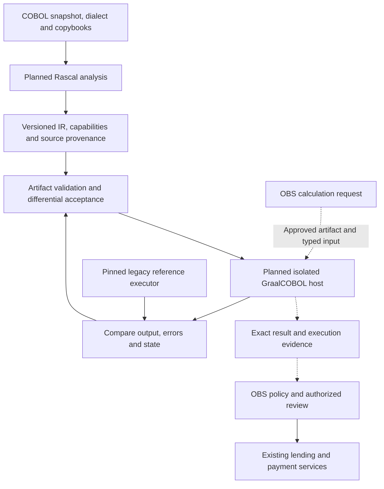

# GraalCOBOL dependency integration

JFXAI4OBS registers [sdk2035/GraalCOBOL](https://github.com/sdk2035/GraalCOBOL/tree/87bf9c63f62eee5e5a639dac7135c4c70ed3d54c) as a planned legacy-modernization dependency, pinned in [the dependency manifest](../../dependencies/graalcobol.json). Review date: 2026-10-10.

The reviewed upstream contains architecture and migration documentation. Its README explicitly states that the parser, Rascal modules, Truffle runtime, adapters and execution tests are not implemented. OBS therefore has no executable GraalCOBOL integration, package coordinate or installation command to enable. This manifest records the dependency relationship and activation requirements; it does not install a runtime.

## Role and boundaries

GraalCOBOL is proposed for analyzing and migrating a declared COBOL subset using a Rascal frontend, a versioned intermediate representation (IR), and a Truffle/GraalVM runtime behind a host adapter. OBS keeps its canonical financial interfaces, lending engine, payment authorization and reconciliation ownership.

- Rascal analysis and IR generation belong to engineering/build workflows, outside financial request execution.
- The future host adapter accepts only approved artifacts and entry points. The first OBS use case is a deterministic financial calculation on synthetic input, without external effects.
- Execution results provide calculation evidence. They cannot approve a loan, submit a payment, post a ledger entry or update a commercial contract.
- API Mediation Layer remains a separate path to existing mainframe REST services. Cobrix remains a data/copybook ingestion candidate. Neither establishes GraalCOBOL execution compatibility.
- CICS, DB2, JCL, files, advanced layouts and Native Image are outside the first upstream pilot. Preserve legacy services until their specific capabilities and observable behavior are verified.

All GraalCOBOL components and invocation interfaces in this diagram are proposed. The validation feedback applies to a candidate artifact before release; it is not a cyclic financial transaction.

## Proposed OBS adapter contract

This is an application-level design, not an upstream API. A formal schema, implementation and compatibility tests are future deliverables.

| Boundary | Required fields and behavior |
|---|---|
| Request | Schema version, tenant, request/correlation ID, approved program ID, entry point, artifact digest, dialect profile, required capabilities and typed inputs. OBS resolves caller permissions independently. |
| Monetary input | Decimal string with explicit currency, precision/scale and approved rounding policy. Never silently convert ledger amounts to floating point. |
| Response | Request ID, program/artifact identity, exact typed result, native return/error details, evidence reference and execution status. A transport success is not financial approval. |
| Validation | Reject unknown versions/capabilities, unapproved artifacts/entry points, malformed decimal values and layout mismatches before invocation. |
| Isolation | One managed context per job/session; no shared mutable context across tenants, external credentials or production writes in the first pilot. |
| Failure | Distinguish validation rejection, timeout and execution failure. No automatic legacy fallback that changes semantics; return to the explicitly approved route. |
| Provenance | Retain source/copybook hashes, tool versions, IR digest, dialect, reference executor configuration and comparison evidence. Logs omit unnecessary financial/personal records. |

## Activation and delivery gates

| Gate | Acceptance requirement |
|---|---|
| OBS-GC0 | Upstream provides a reproducible build, exact version matrix and reviewed licenses; OBS chooses one explicit dialect and synthetic corpus. |
| OBS-GC1 | Source → Rascal → validated IR → Truffle → captured result works for the declared pure-calculation subset; unsupported constructs fail explicitly. |
| OBS-GC2 | OBS host conversion preserves sign, scale, precision, errors and outputs against the pinned reference executor. Positive, negative, zero and out-of-range cases pass. |
| OBS-GC3 | Isolated shadow pilot validates limits, timeout, tenant separation, provenance and disabled financial writes. No production request is routed to the candidate. |
| OBS-GC4 | Owner accepts comparison evidence and rehearsed rollback; any later side effects require a separate adapter, transaction-owner decision and reconciliation tests. |

Priority is **P2 conditional** for modernization planning. Promote the evaluation when an identified OBS COBOL calculation requires migration; do not promote runtime adoption before these gates pass. The selected lending engine remains authoritative while the dependency is inactive.

## Sources

- [Pinned upstream README](https://github.com/sdk2035/GraalCOBOL/blob/87bf9c63f62eee5e5a639dac7135c4c70ed3d54c/README.md): current implementation status and project scope.
- [Pinned integration architecture](https://github.com/sdk2035/GraalCOBOL/blob/87bf9c63f62eee5e5a639dac7135c4c70ed3d54c/docs/architecture/integration.md): Rascal/IR/Truffle separation, host contracts and transaction ownership.
- [Pinned migration roadmap](https://github.com/sdk2035/GraalCOBOL/blob/87bf9c63f62eee5e5a639dac7135c4c70ed3d54c/docs/migration/roadmap.md): initial subset, differential validation and rollback gates.

[Back to OBS](../../README.md)
